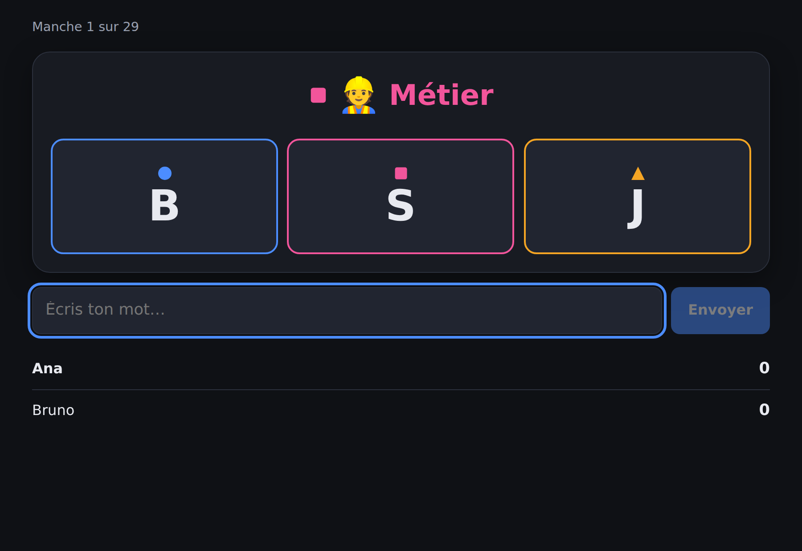
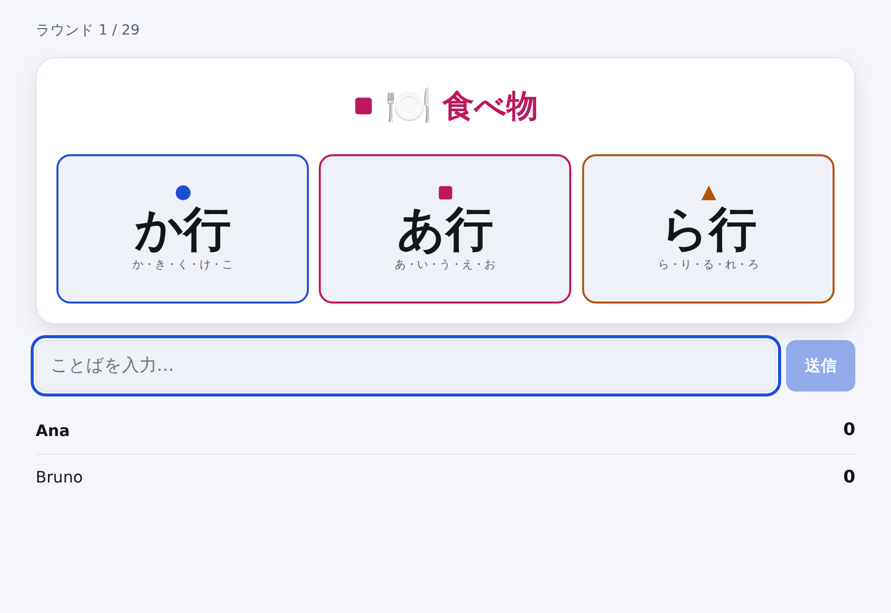

# Lexo

**Un juego de palabras rápido para cuatro idiomas.** Una categoría, tres letras
de colores y una carrera por decir algo que encaje. Se juega en **español,
francés, portugués y japonés** — no traducido a ellos, sino *diseñado* para
ellos.

*[English](README.md) · [Français](README.fr.md) · [Português](README.pt.md) · [日本語](README.ja.md)*

<p align="center">
  
</p>

La categoría lleva un color. Exactamente una de las tres letras lleva el mismo.
Di una profesión que empiece por **S** antes que nadie y la carta es tuya. Si
fallas la correspondencia de color, responderás con la letra equivocada — y en
eso consiste casi todo el juego.

---

## Por qué existe

Los juegos de palabras de este tipo casi siempre se construyen para un idioma y
después se traducen, lo que los rompe en silencio. «Que empiece por Q» es una
restricción divertida en portugués, una ronda muerta en francés y no significa
absolutamente nada en japonés, donde las palabras no empiezan por letras.

Lexo trata eso como el problema de diseño, no como un detalle posterior:

- **Cada idioma trae su propio alfabeto.** Las letras que puede mostrar una
  carta salen del idioma que se está jugando.
- **El japonés se juega por filas de kana.** Una carta pide な行 — な, に, ぬ,
  ね o の — porque un solo kana es demasiado estrecho para ser divertido. Los
  kana sonoros caen en su fila, así que `ごりら` cuenta para か行, igual que se
  jugaría en voz alta.
- **Nunca se reparte una carta sin respuesta posible.** Cada pareja
  categoría/letra se comprueba contra el banco de palabras, así que «un país
  con O» nunca llega a la mesa en español.
- **Acentos, artículos y ligaduras se perdonan.** `aguila` vale por `águila`,
  `l'ours` por `ours`, `oeuf` por `œuf`. Nadie debería perder una ronda por el
  teclado del móvil.

Detalles en [`docs/LANGUAGES.md`](docs/LANGUAGES.md) (en inglés).

---

## Jugar

```bash
git clone https://github.com/wilsonhj/lexo.git
cd lexo
npm install
npm run dev
```

Abre <http://localhost:5173>, crea una partida y envía el código de sala de
cuatro letras a quien vayas a jugar. Eso es toda la instalación: sin cuentas,
sin base de datos, sin claves de API.

Para una versión de producción en un solo proceso:

```bash
npm run build
npm start          # http://localhost:8080
```

Necesita Node 20 o superior.

---

## El juego

| | |
|---|---|
| **Jugadores** | 2–6, o 1 en modo práctica |
| **Una ronda** | Una categoría y tres letras de colores. La primera respuesta válida gana la carta. |
| **Una partida** | Termina cuando queda una carta en la reserva — esa última nunca se juega. |
| **Ganar** | Más cartas. Los empates se deciden por tiempo medio de respuesta. |

**Cinco modos**, que no son más que combinaciones de ajustes:

- **Clásico** — sin reloj; la ronda dura hasta que alguien acierta.
- **Contrarreloj** — 20 segundos por ronda; las cartas sin respuesta se descartan.
- **Peques** — categorías sencillas, sin reloj, se pueden repetir palabras.
- **Equipos** — dos equipos, una sola respuesta por equipo y ronda. Fallar la gasta.
- **Solo** — tú contra el reloj, juzgado estrictamente por el banco de palabras.

Reglas completas en [`docs/RULES.md`](docs/RULES.md) (en inglés).

### Cuando el juego no conoce una palabra

El banco de palabras es una ventaja inicial, no un diccionario: nunca contendrá
todas las respuestas válidas. Por eso una palabra desconocida con la letra
correcta no pierde, sino que pasa a **votación de cinco segundos** entre los
demás jugadores. La mayoría la acepta; **un empate la rechaza**. El reloj de la
ronda se detiene mientras se vota.

Las palabras aceptadas por votación aparecen al final de la partida, listas
para [proponerlas al banco](docs/WORD_BANKS.md).

<p align="center">
  
</p>

---

## Bancos de palabras

**2.562 palabras** en cuatro idiomas, escritas a mano y verificadas en CI.

| Idioma | Palabras | Parejas categoría/letra jugables |
|---|---:|---:|
| Español | 757 | 165 / 176 |
| Français | 710 | 153 / 176 |
| Português | 730 | 168 / 176 |
| 日本語 | 365 | 76 / 80 |

Ocho categorías: animal, país, ciudad, comida, objeto, profesión, planta y
nombre.

Añadir palabras es la forma más fácil de ayudar, y el informe te dice
exactamente dónde están los huecos:

```bash
npm run bank:check
```

Cada pareja que aparezca como «almost playable» está a una o dos palabras de
salir en las partidas.

---

## Estructura

```
packages/
  core/     Reglas, bancos de palabras, validación.  Puro, sin dependencias.
  server/   Servidor autoritativo.                   Node + ws.
  client/   Cliente de navegador.                    React + Vite.
```

El servidor manda: es dueño de la reserva, del reloj y de los puntos, y marca
la hora de cada respuesta al recibirla en lugar de fiarse del cliente. El
cliente usa *el mismo* código de validación para que la interfaz responda al
instante, pero no decide nada.

```bash
npm test          # 79 pruebas
npm run smoke     # arranca el servidor y juega una partida real por WebSocket
npm run typecheck
```

---

## Contribuir

Palabras, idiomas, informes de errores y traducciones: todo es bienvenido.
Empieza por [`CONTRIBUTING.md`](CONTRIBUTING.md).

Añadir un **quinto idioma** son una entrada de configuración y un banco de
palabras.

---

## Créditos e independencia

Lexo toma su forma de una familia de juegos de mesa de rapidez con palabras:
una categoría, una letra y una carrera. La mecánica es antigua y de uso común;
el nombre, la identidad visual, los bancos de palabras, el texto de las reglas
y cada línea de código son originales de este proyecto. No se reproduce
contenido de ninguna editorial.

Licencia MIT. Ver [`LICENSE`](LICENSE).
