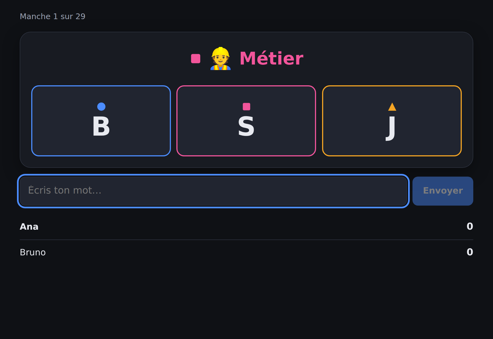
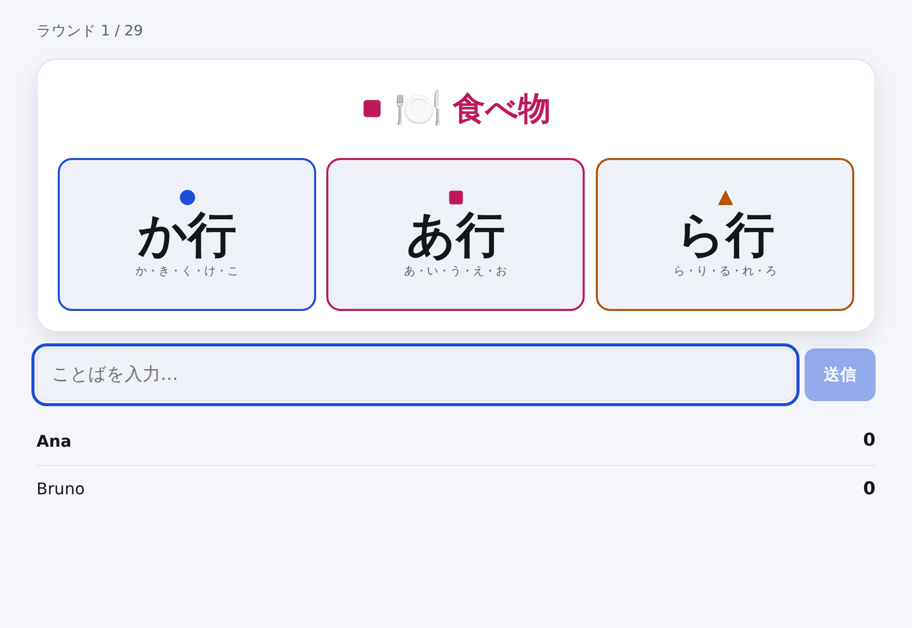

# Lexo

**Un jeu de mots rapide pour quatre langues.** Une catégorie, trois lettres
colorées, et une course pour dire quelque chose qui convient. Jouable en
**espagnol, français, portugais et japonais** — pas traduit dans ces langues,
mais *conçu* pour elles.

*[English](README.md) · [Español](README.es.md) · [Português](README.pt.md) · [日本語](README.ja.md)*

<p align="center">
  
</p>

La catégorie porte une couleur. Une seule des trois lettres porte la même.
Trouve un métier commençant par **S** avant les autres et la carte est à toi.
Rate la correspondance de couleur et tu répondras sur la mauvaise lettre — et
c'est là que se joue l'essentiel.

---

## Pourquoi ce projet

Les jeux de mots de ce genre sont presque toujours construits pour une langue
puis traduits, ce qui les casse discrètement. « Commençant par Q » est une
contrainte amusante en portugais, une manche morte en français, et n'a
strictement aucun sens en japonais, où les mots ne commencent pas par des
lettres.

Lexo en fait le problème de conception plutôt qu'un détail :

- **Chaque langue apporte son alphabet.** Les lettres qu'une carte peut
  afficher viennent de la langue jouée.
- **Le japonais se joue par lignes de kana.** Une carte demande な行 — な, に,
  ぬ, ね ou の — parce qu'un kana isolé est bien trop étroit pour être amusant.
  Les kana voisés retombent sur leur ligne : `ごりら` compte pour か行, comme à
  l'oral.
- **Aucune carte sans réponse possible n'est distribuée.** Chaque paire
  catégorie/lettre est vérifiée contre la banque de mots, donc « un pays en O »
  n'arrive jamais sur la table en espagnol.
- **Accents, articles et ligatures sont pardonnés.** `aguila` vaut `águila`,
  `l'ours` vaut `ours`, `oeuf` vaut `œuf`. Personne ne devrait perdre une
  manche à cause d'un clavier de téléphone.

Détails dans [`docs/LANGUAGES.md`](docs/LANGUAGES.md) (en anglais).

---

## Jouer

```bash
git clone https://github.com/wilsonhj/lexo.git
cd lexo
npm install
npm run dev
```

Ouvre <http://localhost:5173>, crée une partie et envoie le code de salon à
quatre lettres à tes camarades. C'est toute l'installation : pas de compte, pas
de base de données, pas de clé d'API.

Pour une version de production dans un seul processus :

```bash
npm run build
npm start          # http://localhost:8080
```

Node 20 ou plus récent.

---

## Le jeu

| | |
|---|---|
| **Joueurs** | 2–6, ou 1 en entraînement |
| **Une manche** | Une catégorie et trois lettres colorées. La première réponse valide emporte la carte. |
| **Une partie** | Se termine quand il ne reste qu'une carte dans la réserve — celle-ci n'est jamais jouée. |
| **Gagner** | Le plus de cartes. Les égalités se départagent au temps de réponse moyen. |

**Cinq modes**, qui ne sont que des ensembles de réglages :

- **Classique** — sans chrono ; la manche dure jusqu'à ce que quelqu'un trouve.
- **Chrono** — 20 secondes par manche ; les cartes sans réponse sont écartées.
- **Enfants** — catégories simples, sans horloge, mots réutilisables.
- **Équipes** — deux équipes, une seule réponse par équipe et par manche. Se
  tromper la dépense.
- **Entraînement** — toi contre la montre, jugé strictement par la banque de mots.

Règles complètes dans [`docs/RULES.md`](docs/RULES.md) (en anglais).

### Quand le jeu ne connaît pas un mot

La banque de mots est une avance, pas un dictionnaire : elle ne contiendra
jamais toutes les réponses valides. Un mot inconnu commençant par la bonne
lettre ne perd donc pas — il passe au **vote de cinq secondes** des autres
joueurs. La majorité l'accepte ; **une égalité le rejette**. Le chronomètre de
la manche est mis en pause pendant le vote : discuter d'un mot ne doit pas
coûter leur temps aux autres.

Les mots acceptés au vote sont listés en fin de partie, prêts à être
[proposés à la banque](docs/WORD_BANKS.md).

<p align="center">
  
</p>

---

## Banques de mots

**2 562 mots** dans quatre langues, écrits à la main et vérifiés en CI.

| Langue | Mots | Paires catégorie/lettre jouables |
|---|---:|---:|
| Español | 757 | 165 / 176 |
| Français | 710 | 153 / 176 |
| Português | 730 | 168 / 176 |
| 日本語 | 365 | 76 / 80 |

Huit catégories : animal, pays, ville, nourriture, objet, métier, plante et
prénom.

Ajouter des mots est la contribution la plus simple, et le rapport indique
exactement où sont les trous :

```bash
npm run bank:check
```

Chaque paire signalée « almost playable » est à un ou deux mots d'apparaître
dans les parties.

---

## Structure

```
packages/
  core/     Règles, banques de mots, validation.  Pur, sans dépendances.
  server/   Serveur autoritaire.                  Node + ws.
  client/   Client navigateur.                    React + Vite.
```

Le serveur fait autorité : il possède la réserve, l'horloge et les scores, et
horodate chaque réponse à sa réception plutôt que de croire le client. Le
client exécute *le même* code de validation pour que l'interface réagisse
immédiatement, mais il ne décide de rien.

```bash
npm test          # 79 tests
npm run smoke     # démarre le serveur et joue une vraie partie via WebSocket
npm run typecheck
```

---

## Contribuer

Mots, langues, rapports de bugs et traductions : tout est bienvenu. Commence
par [`CONTRIBUTING.md`](CONTRIBUTING.md).

Ajouter une **cinquième langue** demande une entrée de configuration et une
banque de mots.

---

## Crédits et indépendance

Lexo emprunte sa forme à une famille de jeux de société de rapidité verbale :
une catégorie, une lettre, une course. La mécanique est ancienne et largement
répandue ; le nom, l'identité visuelle, les banques de mots, le texte des
règles et chaque ligne de code sont originaux. Aucun contenu d'éditeur n'est
reproduit.

Licence MIT. Voir [`LICENSE`](LICENSE).
