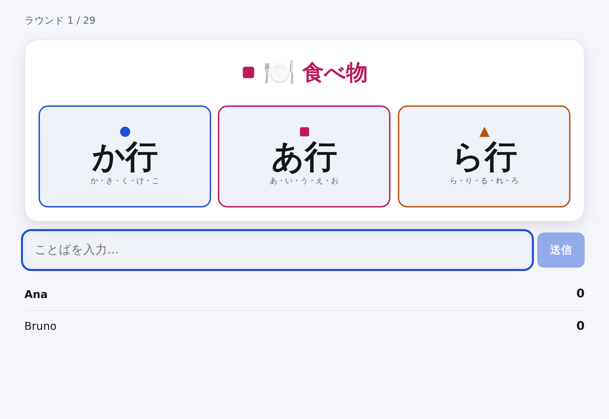

# Lexo

**4言語で遊べる、はやいもの勝ちのことばゲーム。** カテゴリーがひとつ、色つきの文字が
3つ。あてはまることばを、いちばん早く言った人の勝ちです。**スペイン語・フランス語・
ポルトガル語・日本語**に対応しています。翻訳したのではなく、それぞれの言語のために
設計しています。

*[English](README.md) · [Español](README.es.md) · [Français](README.fr.md) · [Português](README.pt.md)*

<p align="center">
  
</p>

カテゴリーには色がついています。3つの文字のうち、同じ色のものはひとつだけ。その行で
はじまることばを、ほかの人より先に答えればカードがもらえます。色の対応を見まちがえる
と、ちがう行で答えてしまう — そこがこのゲームのほとんどすべてです。

---

## なぜ作ったのか

この種のことばゲームは、たいてい1つの言語向けに作られてから翻訳されます。そして静かに
壊れます。「Qではじまることば」はポルトガル語なら楽しい制約ですが、フランス語では
ほぼ成立せず、日本語にいたっては意味をなしません。日本語のことばは「文字」では
はじまらないからです。

Lexo はそれを後回しの問題ではなく、設計そのものとして扱います。

- **言語ごとに自分の文字セットを持ちます。** カードに出る文字は、いま遊んでいる言語
  から決まります。
- **日本語は「行」で遊びます。** カードは な行（な・に・ぬ・ね・の）を要求します。
  かな1文字では狭すぎて、ゲームが止まってしまうからです。濁音は元の行に戻るので、
  `ごりら` は か行 として有効。声に出して遊ぶときと同じ感覚です。
- **答えられないカードは配りません。** カテゴリーと文字の組み合わせは、必ず辞書に
  照らして確認されます。だからスペイン語で「Oではじまる国」は出てきません。
- **アクセント・冠詞・合字は寛容に扱います。** `aguila` は `águila`、`l'ours` は
  `ours`、`oeuf` は `œuf` として通ります。スマホのキーボードのせいで負けるべきでは
  ありません。

くわしくは [`docs/LANGUAGES.md`](docs/LANGUAGES.md)（英語）。

---

## 遊びかた

```bash
git clone https://github.com/wilsonhj/lexo.git
cd lexo
npm install
npm run dev
```

<http://localhost:5173> を開いてゲームを作り、4文字のルームコードを一緒に遊ぶ人に
送るだけ。アカウントもデータベースも API キーも必要ありません。

本番用（1プロセスで配信）:

```bash
npm run build
npm start          # http://localhost:8080
```

Node 20 以上が必要です。

---

## ゲームの流れ

| | |
|---|---|
| **人数** | 2〜6人、ひとり練習なら1人 |
| **1ラウンド** | カテゴリーと色つきの文字3つ。最初の正解がカードを取ります。 |
| **1ゲーム** | 山札が残り1枚になったら終了。その最後の1枚は使いません。 |
| **勝敗** | カードの枚数。同数なら平均回答タイムで決まります。 |

**5つのモード**。中身は設定の組み合わせで、ラウンドの進行はどれも同じです。

- **クラシック** — 制限時間なし。誰かが正解するまで続きます。
- **タイムアタック** — 1ラウンド20秒。誰も答えられなければカードは捨て札に。
- **キッズ** — やさしいカテゴリー、制限時間なし、同じことばの再利用OK。
- **チーム戦** — 2チーム。各チーム1ラウンド1回だけ回答でき、まちがえると使い切ります。
- **ひとり練習** — 時間との勝負。辞書に載っていることばだけが有効です。

くわしい規則は [`docs/RULES.md`](docs/RULES.md)（英語）。

### 辞書にないことばを答えたら

辞書はあくまで出発点で、すべての正解を網羅することはありません。そこで、行が合っている
のに辞書にないことばは、負けにはならず**5秒間の投票**にかけられます。過半数で承認、
**同数なら不承認**です。投票のあいだラウンドの時計は止まるので、議論がほかの人の時間を
削ることはありません。

投票で認められたことばはゲーム終了時に一覧表示され、そのまま
[辞書への提案](docs/WORD_BANKS.md)に使えます。

### 漢字について

`犬` という表記から読みを機械的に導くことはできません。Lexo は形態素解析器に依存しない
方針なので、次の3通りで対応しています。

1. **辞書が知っている場合** — 日本語の辞書項目はすべて読みを持っています（`犬|いぬ`）。
2. **かなで入力した場合** — `いぬ` も `イヌ` もそのまま判定できます。IME を使うなら
   これがふつうの流れです。
3. **読みを添えた場合** — 辞書にないことばは `猫 ねこ`、`猫（ねこ）`、`猫|ねこ` の
   いずれかで入力できます。

なお、変換中の Enter で送信されないようになっています。漢字変換の Enter が
そのまま回答になってしまっては、まともに遊べないからです。

---

## ことばの辞書

4言語あわせて**2,562語**。すべて手作業で用意し、CI で検証しています。

| 言語 | 語数 | 使えるカテゴリー/文字の組み合わせ |
|---|---:|---:|
| Español | 757 | 165 / 176 |
| Français | 710 | 153 / 176 |
| Português | 730 | 168 / 176 |
| 日本語 | 365 | 76 / 80 |

カテゴリーは8つ：動物・国・都市・食べ物・もの・職業・植物・名前。

ことばを足すのがいちばん簡単な貢献です。どこが足りないかはコマンドが教えてくれます。

```bash
npm run bank:check
```

「almost playable」と表示された組み合わせは、あと1〜2語でゲームに登場するようになります。

---

## 構成

```
packages/
  core/     ルール・辞書・判定。      純粋、依存ゼロ。
  server/   権威を持つゲームサーバー。 Node + ws。
  client/   ブラウザークライアント。   React + Vite。
```

判定の権限はサーバーにあります。山札・時計・得点はサーバーが持ち、回答の時刻は
受信した瞬間にサーバー側で記録します（クライアントの申告は使いません）。
クライアントは*同じ*判定コードを動かして画面の反応を速くしますが、何も決定しません。

```bash
npm test          # 79 件のテスト
npm run smoke     # サーバーを起動して WebSocket 越しに実際に1ゲーム遊ぶ
npm run typecheck
```

---

## 貢献する

ことば、言語の追加、バグ報告、翻訳、どれも歓迎です。まずは
[`CONTRIBUTING.md`](CONTRIBUTING.md) を読んでください。

**5つめの言語**を追加するのに必要なのは、設定1件と辞書1つだけです。

日本語の訳文の改善もぜひお願いします。訳は丁寧に書いたつもりですが、母語話者の
自然さにはかないません。

---

## 出典と独立性

Lexo は、カテゴリーと文字とスピード勝負という、テーブルゲームの古くからある形式を
下敷きにしています。この仕組み自体は広く使われているものです。一方で、名前・
ビジュアル・辞書・規則の文章・コードはすべてこのプロジェクトのオリジナルであり、
特定の出版社のコンテンツを複製したものではありません。

MIT ライセンス。[`LICENSE`](LICENSE) を参照してください。
