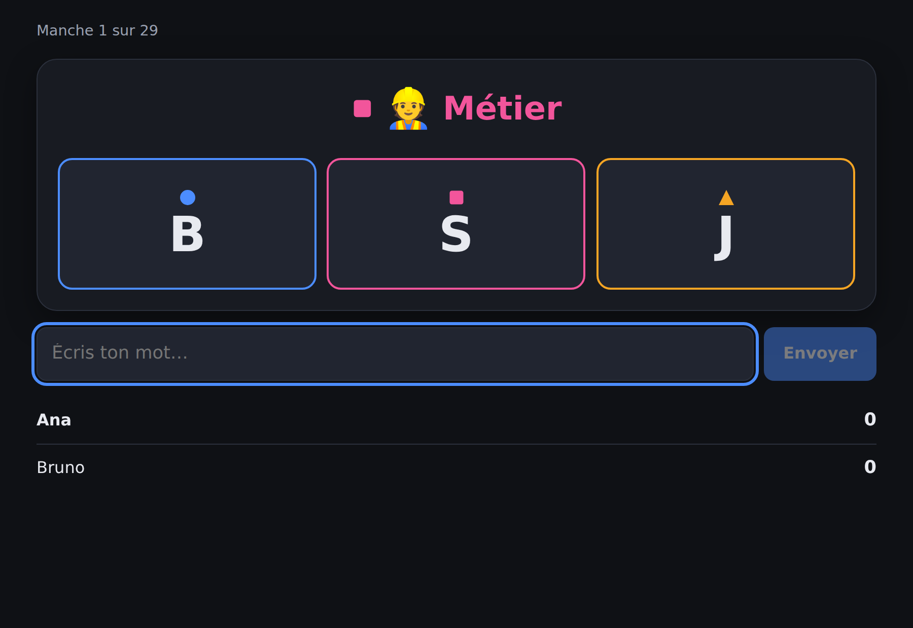
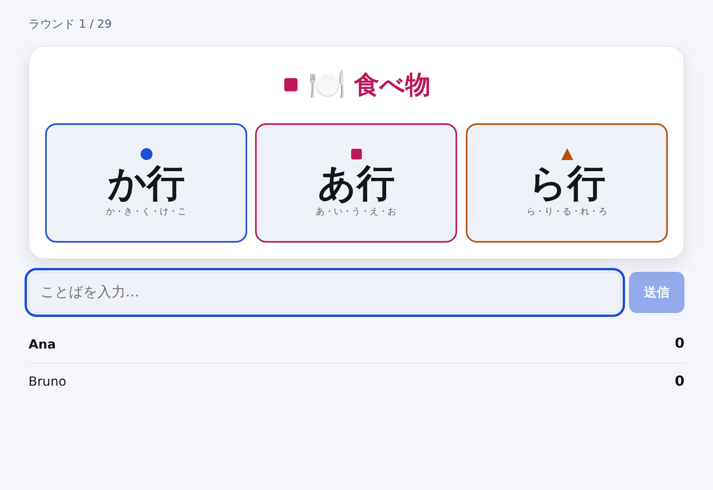

# Lexo

**A fast word game for four languages.** One category, three coloured letters,
and a race to say something that fits. Playable in **Spanish, French,
Portuguese and Japanese** — not translated into them, *designed* for them.

*[Español](README.es.md) · [Français](README.fr.md) · [Português](README.pt.md) · [日本語](README.ja.md)*

<p align="center">
  
</p>

The category wears a colour. Exactly one of the three letters wears the same
one. Name a profession starting with **S** before anyone else does, and the
card is yours. Miss the colour match and you will answer the wrong letter —
which is most of the game.

---

## Why this exists

Word games of this shape are almost always built for one language and then
translated, which quietly breaks them. "Starts with the letter Q" is a fun
constraint in Portuguese, a dead round in French, and completely meaningless
in Japanese, where words do not start with letters at all.

Lexo treats that as the design problem rather than an afterthought:

- **Every language brings its own alphabet.** The letters a card can show come
  from the language being played, not from a shared list.
- **Japanese plays by kana rows.** A card asks for な行 — な, に, ぬ, ね or の —
  because a single kana is far too narrow to be fun. Voiced kana fold onto
  their row, so `ごりら` counts for か行, exactly as it would out loud.
- **A card is never dealt that cannot be answered.** Every category/letter pair
  is checked against the word bank first, so "a country starting with O" never
  reaches the table in Spanish.
- **Accents, articles and ligatures are forgiving.** `aguila` counts for
  `águila`, `l'ours` for `ours`, `oeuf` for `œuf`. Nobody should lose a round
  to a phone keyboard.

See [`docs/LANGUAGES.md`](docs/LANGUAGES.md) for how each language is handled.

---

## Play it

```bash
git clone https://github.com/wilsonhj/lexo.git
cd lexo
npm install
npm run dev
```

Open <http://localhost:5173>, create a game, and send the four-letter room
code to whoever you are playing with. That is the whole setup — no account, no
database, no API keys.

For a production build served from a single process:

```bash
npm run build
npm start          # http://localhost:8080
```

Requires Node 20 or newer. See [`docs/SELF_HOSTING.md`](docs/SELF_HOSTING.md)
to put it on a real host.

---

## The game

| | |
|---|---|
| **Players** | 2–6, or 1 in solo practice |
| **A round** | A category and three coloured letters. First valid answer wins the card. |
| **A game** | Ends when one card is left in the reserve — that last card is never played, as in the tabletop game this borrows its shape from. |
| **Winning** | Most cards. Ties break on average answer time. |

**Five modes**, which are only bundles of settings — the round loop is the same
in all of them:

- **Classic** — no clock; the round runs until somebody lands it.
- **Chrono** — 20 seconds a round; unanswered cards are discarded.
- **Kids** — simple categories, no clock, words may be reused.
- **Teams** — two teams, one answer per team per round. A wrong guess spends it.
- **Solo** — you against the clock, judged strictly by the word bank.

Full rules, including how contested words are settled, are in
[`docs/RULES.md`](docs/RULES.md).

### When the game does not know a word

The word bank is a head start, not a dictionary — it will never contain every
valid answer. So an unknown word with the right initial does not lose; it goes
to a **five-second vote** by the other players. Majority accepts, a tie
rejects. Words voted through are collected and shown at the end of the game,
ready to be [contributed back](docs/WORD_BANKS.md).

<p align="center">
  
</p>

---

## Word banks

**2,562 words** across four languages, hand-written and checked in CI.

| Language | Words | Playable category/letter pairs |
|---|---:|---:|
| Español | 757 | 165 / 176 |
| Français | 710 | 153 / 176 |
| Português | 730 | 168 / 176 |
| 日本語 | 365 | 76 / 80 |

Eight categories: animal, country, city, food, object, profession, plant and
first name.

Adding words is the easiest way to help, and the report tells you exactly where
the gaps are:

```bash
npm run bank:check
```

```
Español  (es)
────────────────────────────────────────────────────
  757 words · 165/176 playable pairs (need 3+ words each)

  Almost playable — 2 or fewer words:
      · Country/D (2)
      · Food/U (1)
```

Every pair listed there is one or two words away from appearing in games.
[`docs/WORD_BANKS.md`](docs/WORD_BANKS.md) has the details.

---

## How it fits together

```
packages/
  core/     Rules, word banks, validation.  Pure, no dependencies.
  server/   Authoritative game server.      Node + ws.
  client/   Browser client.                 React + Vite.
```

The server is the authority: it owns the reserve, the clock and the scores, and
it stamps every answer on arrival rather than trusting a client's timestamp.
The client imports the *same* validation code so it can keep the UI honest
without a round trip, but it never decides anything.

- [`docs/ARCHITECTURE.md`](docs/ARCHITECTURE.md) — why it is shaped this way,
  and what the timing model does and does not guarantee.
- [`docs/PROTOCOL.md`](docs/PROTOCOL.md) — every message on the wire.

### Tests

```bash
npm test          # 79 unit + integration tests
npm run smoke     # boots the server and plays a real game over WebSocket
npm run typecheck
```

The bank tests are worth knowing about: every word in every bank must compile
to a valid initial and be accepted back by the validator. A typo in a Japanese
reading fails CI rather than a game night.

---

## Contributing

Words, languages, bug reports and translations are all welcome. Start with
[`CONTRIBUTING.md`](CONTRIBUTING.md).

Adding a **fifth language** takes one config entry and one word bank —
[`docs/LANGUAGES.md`](docs/LANGUAGES.md) walks through it.

---

## Credits and independence

Lexo takes its shape from a family of tabletop speed word games — a category, a
letter, and a race. The mechanic is old and widely used; the name, the visual
identity, the word banks, the rules text and every line of code here are
original to this project. No publisher's content is reproduced.

MIT licensed. See [`LICENSE`](LICENSE).
