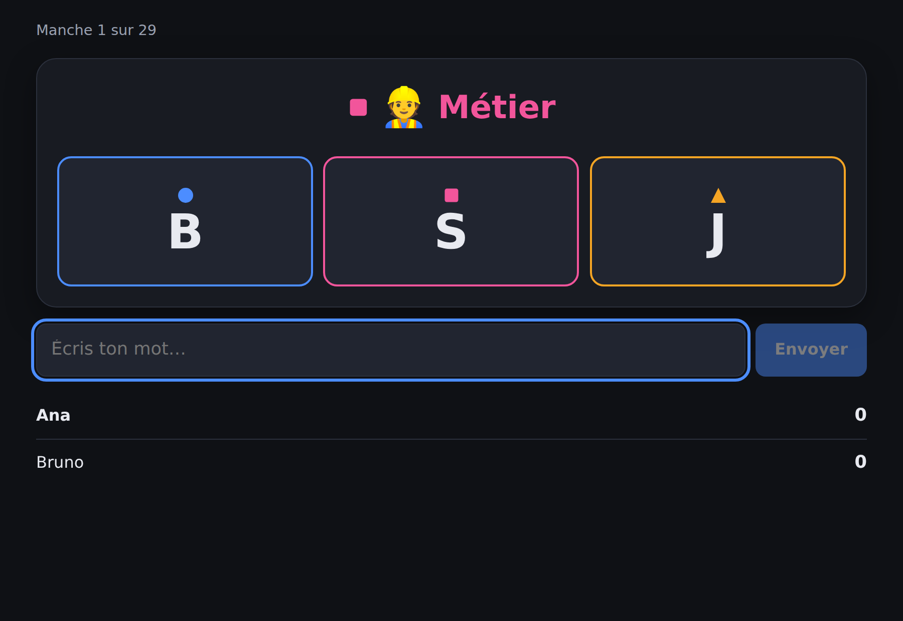
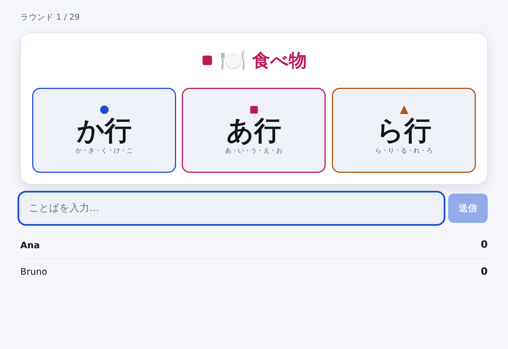

# Lexo

**Um jogo de palavras rápido para quatro idiomas.** Uma categoria, três letras
coloridas e uma corrida para dizer algo que sirva. Jogável em **espanhol,
francês, português e japonês** — não traduzido para eles, mas *projetado* para
eles.

*[English](README.md) · [Español](README.es.md) · [Français](README.fr.md) · [日本語](README.ja.md)*

<p align="center">
  
</p>

A categoria tem uma cor. Exatamente uma das três letras tem a mesma. Diga uma
profissão começando por **S** antes de todo mundo e a carta é sua. Erre a
correspondência de cor e vai responder pela letra errada — e é aí que o jogo
acontece.

---

## Por que existe

Jogos de palavras desse tipo quase sempre são feitos para um idioma e depois
traduzidos, o que os quebra silenciosamente. «Começando com Q» é uma restrição
divertida em português, uma rodada morta em francês, e não significa
absolutamente nada em japonês, onde as palavras não começam com letras.

O Lexo trata isso como o problema de design, não como um detalhe:

- **Cada idioma traz o próprio alfabeto.** As letras que uma carta pode mostrar
  vêm do idioma que está sendo jogado.
- **O japonês é jogado por linhas de kana.** Uma carta pede な行 — な, に, ぬ,
  ね ou の — porque um único kana é estreito demais para ser divertido. Kana
  sonoros caem na sua linha, então `ごりら` vale para か行, como se jogaria em
  voz alta.
- **Nunca é dada uma carta sem resposta possível.** Cada par categoria/letra é
  conferido contra o banco de palavras, então «um país com O» nunca chega à
  mesa em espanhol.
- **Acentos, artigos e ligaduras são perdoados.** `aguila` vale `águila`,
  `l'ours` vale `ours`, `oeuf` vale `œuf`. Ninguém deveria perder uma rodada
  por causa do teclado do celular.

Detalhes em [`docs/LANGUAGES.md`](docs/LANGUAGES.md) (em inglês).

---

## Jogar

```bash
git clone https://github.com/wilsonhj/lexo.git
cd lexo
npm install
npm run dev
```

Abra <http://localhost:5173>, crie uma partida e mande o código de sala de
quatro letras para quem vai jogar. Essa é toda a instalação: sem contas, sem
banco de dados, sem chaves de API.

Para uma versão de produção em um único processo:

```bash
npm run build
npm start          # http://localhost:8080
```

Requer Node 20 ou mais novo.

---

## O jogo

| | |
|---|---|
| **Jogadores** | 2–6, ou 1 no treino |
| **Uma rodada** | Uma categoria e três letras coloridas. A primeira resposta válida leva a carta. |
| **Uma partida** | Termina quando resta uma carta na reserva — essa última nunca é jogada. |
| **Vencer** | Mais cartas. Empates são decididos pelo tempo médio de resposta. |

**Cinco modos**, que são apenas conjuntos de configurações:

- **Clássico** — sem relógio; a rodada dura até alguém acertar.
- **Cronômetro** — 20 segundos por rodada; cartas sem resposta são descartadas.
- **Crianças** — categorias simples, sem relógio, palavras podem repetir.
- **Times** — dois times, uma resposta por time por rodada. Errar gasta a vez.
- **Treino** — você contra o relógio, julgado estritamente pelo banco de palavras.

Regras completas em [`docs/RULES.md`](docs/RULES.md) (em inglês).

### Quando o jogo não conhece uma palavra

O banco de palavras é uma vantagem inicial, não um dicionário: nunca vai conter
todas as respostas válidas. Por isso uma palavra desconhecida com a letra certa
não perde — ela vai para uma **votação de cinco segundos** entre os outros
jogadores. A maioria aceita; **um empate rejeita**. O relógio da rodada fica
pausado durante a votação.

Palavras aceitas por votação aparecem no fim da partida, prontas para serem
[sugeridas ao banco](docs/WORD_BANKS.md).

<p align="center">
  
</p>

---

## Bancos de palavras

**2.562 palavras** em quatro idiomas, escritas à mão e verificadas em CI.

| Idioma | Palavras | Pares categoria/letra jogáveis |
|---|---:|---:|
| Español | 757 | 165 / 176 |
| Français | 710 | 153 / 176 |
| Português | 730 | 168 / 176 |
| 日本語 | 365 | 76 / 80 |

Oito categorias: animal, país, cidade, comida, objeto, profissão, planta e nome.

Adicionar palavras é a forma mais fácil de ajudar, e o relatório mostra
exatamente onde estão os buracos:

```bash
npm run bank:check
```

Cada par listado como «almost playable» está a uma ou duas palavras de aparecer
nas partidas.

---

## Estrutura

```
packages/
  core/     Regras, bancos de palavras, validação.  Puro, sem dependências.
  server/   Servidor autoritativo.                  Node + ws.
  client/   Cliente de navegador.                   React + Vite.
```

O servidor manda: é dono da reserva, do relógio e da pontuação, e marca a hora
de cada resposta ao recebê-la em vez de confiar no cliente. O cliente roda *o
mesmo* código de validação para a interface responder na hora, mas não decide
nada.

```bash
npm test          # 79 testes
npm run smoke     # sobe o servidor e joga uma partida real por WebSocket
npm run typecheck
```

---

## Contribuir

Palavras, idiomas, relatos de bugs e traduções: tudo é bem-vindo. Comece por
[`CONTRIBUTING.md`](CONTRIBUTING.md).

Adicionar um **quinto idioma** exige uma entrada de configuração e um banco de
palavras.

---

## Créditos e independência

O Lexo pega a forma de uma família de jogos de tabuleiro de rapidez com
palavras: uma categoria, uma letra e uma corrida. A mecânica é antiga e de uso
comum; o nome, a identidade visual, os bancos de palavras, o texto das regras e
cada linha de código são originais deste projeto. Nenhum conteúdo de editora é
reproduzido.

Licença MIT. Veja [`LICENSE`](LICENSE).
